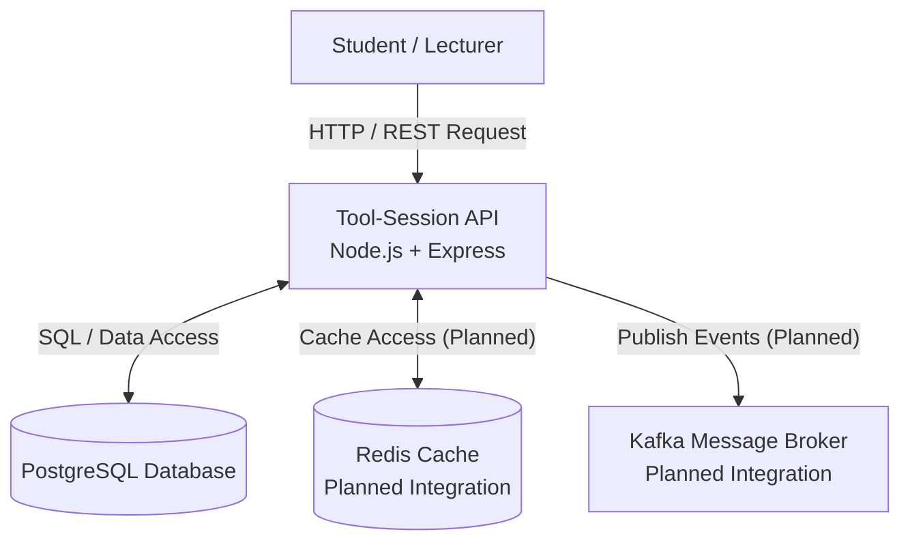

# RP-Cloud Labs – Application-view Architecture Diagram

## 1. Introduction

This diagram presents the application architecture of the RP-Cloud Labs Tool-Session Service. It shows how students and lecturers request access to hosted learning tools and how the API communicates with supporting infrastructure components.

## 2. Architecture Diagram

## 3. Description of Components

1. **Student / Lecturer:** Users who request access to hosted learning tools.
2. **Tool-Session API:** The backend application developed using Node.js and Express. It receives and processes requests.
3. **PostgreSQL Database:** Stores application information, such as student details, tools, sessions and software-license capacity.
4. **Redis:** Intended to cache frequently accessed information. Integration with the API is planned.
5. **Kafka:** Intended to support event messaging. Integration with the API is planned.

## 4. Communication Between Components

- Students and lecturers send HTTP/REST requests to the API.
- The API uses SQL to store and retrieve information from PostgreSQL.
- Redis is planned for caching.
- Kafka is planned for publishing application events.

## 5. Architecture Principles

The architecture supports separation of concerns by assigning different responsibilities to the API, database, caching and messaging components.

## 6. Conclusion

The diagram provides an overview of the main components and communication relationships of the RP-Cloud Labs Tool-Session Service.
