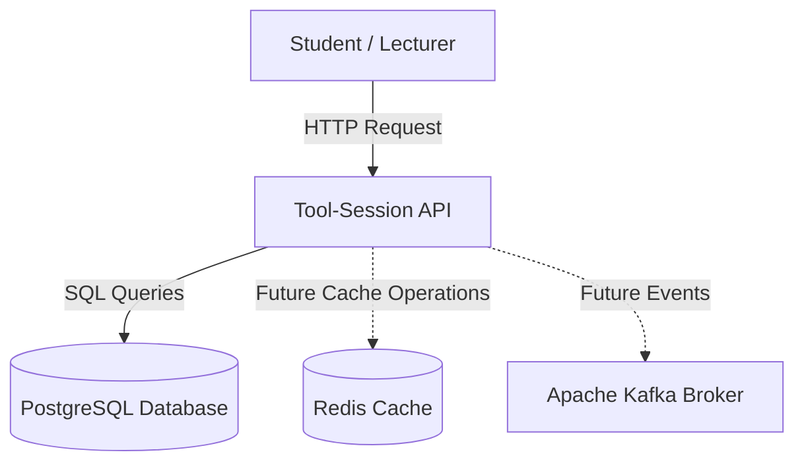

# RP-Cloud Labs Architecture

## Application View

The RP-Cloud Labs Tool-Session Service uses
Microservices Architecture.

### Architecture Diagram

### Component Description

1. Student / Lecturer:
   Requests access to hosted learning tools.

2. Tool-Session API:
   Receives and processes tool-session requests.

3. PostgreSQL:
   Stores tool-session and license information.

4. Redis:
   Provides caching for frequently accessed information.

5. Apache Kafka:
   Supports asynchronous communication using events.